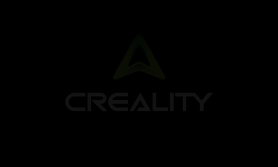
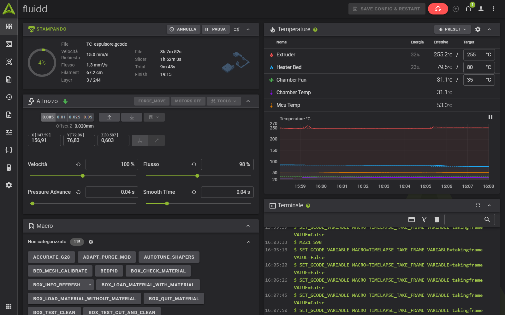

<div align="center">
  
  <h1>ADL Script</h1>
  <p>Macro e strumenti per la Creality K1C rootata con il CFS</p>

  <a href="https://github.com/AlbertoTrento/ADL-Script/commits/main"></a>
  
  <a href="LICENSE"></a>
</div>

## Cos'è

**ADL Script** raccoglie le macro e gli strumenti per la **Creality K1C rootata con il CFS**
(firmware del CFS Upgrade Kit, provato con la `2.3.5.34`). È la versione di
[AlbertoTrento](https://github.com/AlbertoTrento) del CFS Power Script: si avvia via SSH e,
da un menu, installa e toglie i moduli (Moonraker, Fluidd, KAMP, macro, pannello CFS per
Fluidd, diagnostica del CFS e altro). Prima di sostituire un file di configurazione ne
salva una copia, e ogni modulo si può togliere dal menu `[Remove]`.

## Va insieme ad ADL Screen

[ADL Screen](https://github.com/AlbertoTrento/ADL-Screen) è l'interfaccia per il touch
screen della stampante. Lo script la installa dal suo repo
(`[Customize & PowerScreen] Menu → 1`), e il pannello usa le macro di ADL Script: per
esempio `_CARICA_BOBINA_ESTERNA`, in `files/kamp/Start_Print.cfg`, che porta all'ugello il
filamento della bobina esterna. Per questo conviene usarli insieme e tenerli aggiornati tutti
e due.

## Novità

- **Nome ADL Script.** Lo script, l'aggiornamento automatico e l'installazione di ADL Screen
  puntano ai repo di AlbertoTrento. Nuova animazione di avvio: lampo rosso, logo ADL e scritta
  Alberto Dev Labs.
- **Pulizia ugello con le temperature.** All'avvio stampa la pulizia dell'ugello riceve le
  temperature di stampa. Il piatto resta ad almeno 50 °C, ma se è già più caldo tiene la
  temperatura che ha: non aspetta più che si raffreddi.
- **Temperatura di stampa dopo il caricamento del CFS.** Il CFS carica il filamento alla sua
  temperatura; prima dello spurgo l'ugello torna alla temperatura di stampa dello slicer e la
  aspetta.
- **Bobina esterna.** Con il CFS escluso, all'avvio stampa il filamento infilato a mano fino
  all'estrusore viene portato all'ugello e spurgato con gli stessi comandi del firmware CFS
  (posizioni, velocità e pulizia di `box.cfg`). A fine stampa, con la bobina esterna, non
  viene fatto `BOX_END`, che potrebbe tagliare e ritirare il filamento.
- **Pannello CFS di Fluidd con gli id a 6 cifre.** Il CFS a volte salva l'id del materiale con
  un 1 in più (`106003` invece di `06003`): il pannello ora riconosce anche quello.

## Requisiti

- Creality K1C con il firmware del CFS Upgrade Kit.
- Accesso SSH alla stampante come `root`.
- Stampante collegata a Internet, con data e ora giuste (servono per la connessione SSL a GitHub).
- Meglio partire da una stampante pulita (reset di fabbrica). Se Moonraker, Fluidd o Mainsail
  sono stati installati con un altro script, vanno tolti prima.
- **Fluidd**, per il pannello CFS e la sua finestra di diagnostica (in Mainsail non ci sono).

## Installazione

1. Collegati alla stampante via SSH:

   ```sh
   ssh root@IP_DELLA_STAMPANTE
   ```

2. Scarica lo script in `/usr/data/helper-script` (il percorso deve essere proprio questo):

   ```sh
   git clone --depth 1 https://github.com/AlbertoTrento/ADL-Script.git /usr/data/helper-script
   ```

   Se il download si ferma con un errore SSL, lancia questo comando e riprova:

   ```sh
   git config --global http.sslVerify false
   ```

3. Avvia lo script:

   ```sh
   sh /usr/data/helper-script/helper.sh
   ```

   Dopo il primo avvio basta il comando `helper`.

## Aggiornamento

- **Dallo script:** a ogni avvio controlla se su GitHub c'è una versione nuova e chiede se
  aggiornare (`git reset --hard` e `git pull` nella cartella dello script).
- **Da Fluidd o Mainsail:** *Impostazioni → Aggiornamenti software*, voce `CFS-Power-Script`
  (il nome interno è rimasto quello), che scarica da `AlbertoTrento/ADL-Script`.

## Menu

| Menu | Cosa contiene |
|---|---|
| `[Install]` | Moonraker e Nginx, Fluidd, Mainsail, Entware, Klipper Gcode Shell Command, Power Macros, Bed Coordinates Fix, KAMP, Buzzer, ventola di pulizia ugello, Save Z-Offset, Screws Tilt Adjust, M600, Git Backup, Timelapse, Camera, OctoEverywhere, Obico, Mobileraker, CFS Diagnostics, CFS Custom Filaments |
| `[Remove]` | Le stesse voci, per toglierle e rimettere i file originali |
| `[Customize & PowerScreen]` | Installa e togli ADL Screen, interfaccia web Creality, temi di Fluidd, pannello CFS per Fluidd |
| `[Backup & Restore]` | Configurazione di Klipper e database di Moonraker |
| `[Tools]` | Aggiornamenti della configurazione, stampa da cartelle, camera, riavvio dei servizi, pulizia di cache e log, ripristino firmware e reset di fabbrica |
| `[Information]` | Componenti installati e il loro stato |

## Moduli principali

- **Power Macros** (`[Install] → 6`): sostituisce `gcode_macro.cfg`, `printer_params.cfg` e
  `box.cfg` (gli originali restano in `/usr/data/helper-script-backup/power-config/`) e
  aggiunge `STRESS_TEST`, `PID_HOTEND`, `RELOAD_CAMERA`, `CAMERA_OFF` e `CAMERA_ON`. Lo
  spurgo del CFS diventa un solo giro da 100 mm per cambio colore.
- **KAMP** (`[Install] → 8`): mesh del piatto e linea di spurgo adattive. Lo spurgo è separato
  da `START_PRINT`, perché con il CFS il filamento spesso non è ancora caricato: aggiungi
  `ADAPT_PURGE_MOD` alla fine del G-code iniziale dello slicer. È qui che stanno la pulizia
  ugello, l'attesa della temperatura e la bobina esterna descritte nelle novità.
- **Bed Coordinates Fix** (`[Install] → 7`): corregge le coordinate del piatto sballate dal
  firmware CFS. Y usabile fino a 220 mm, ugello che passa sulla spazzola, mesh da `1,1` a
  `220,215`.
- **M600 Support** (`[Install] → 13`): cambio filamento manuale, che il firmware CFS non ha.
  Con ADL Screen si apre il menu del cambio filamento.
- **CFS Diagnostics** (`[Install] → 20`, beta): registra ogni disconnessione del CFS con la
  causa probabile e, se la stampante non sta stampando, prova a resettare l'adattatore USB.
- **CFS Custom Filaments** (`[Install] → 21`): aggiunge i tuoi filamenti al database dei
  materiali, così ADL Screen e Fluidd mostrano cosa c'è davvero in ogni slot.
- **Pannello CFS per Fluidd** (`[Customize & PowerScreen] → 7`): una scheda nella dashboard di
  Fluidd con i quattro slot del CFS, umidità e temperatura del box, modifica delle bobine e
  pulsanti *REFRESH SLOTS* e *CFS DIAGNOSTICS*.

## Schermate

<p align="center">
  
</p>

## Crediti e licenza

ADL Script nasce dal [CFS Power Script](https://github.com/borferkic/K1C-CFS-Power-Script) di
Boris SdK (borferkic), che a sua volta viene dal
[Creality Helper Script](https://github.com/Guilouz/Creality-Helper-Script) di Guilouz e
dagli adattamenti al CFS di [Nik-oli](https://github.com/Nik-oli/Creality-Helper-Script-K1-CFS).

Licenza GNU GPL v3.0: vedi [LICENSE](LICENSE).
